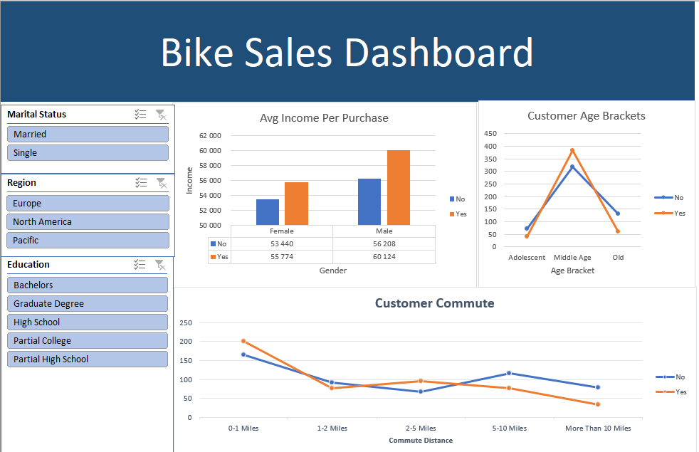

# 🚲 Bike Sales Customer Analysis — Interactive Excel Dashboard

## 📌 Project Overview
In this project, I built an end-to-end **Data Cleaning and Interactive Dashboard pipeline in Microsoft Excel** to analyze customer purchasing behavior for a bicycle retailer. The primary business goal was to identify the key demographic and socioeconomic factors (income, age bracket, commute distance, marital status, and education) that drive a customer's decision to purchase a bike.

📥 **[Download Full Excel Workbook (`Excel_Bike_Project.xlsx`)](./Excel_Bike_Project.xlsx)**

---

## 📊 Interactive Dashboard Preview

---

## 🛠️ Excel Skills & Techniques Demonstrated
* **Data Cleaning & Preparation (`Working Sheet`):**
  * Duplicate removal and data validation.
  * Standardized categorical codes using `FIND & REPLACE` (e.g., transforming `'M'`/`'S'` into `'Married'`/`'Single'` and `'F'`/`'M'` into `'Female'`/`'Male'` for clear business reporting).
  * Feature Engineering: Created custom **Age Brackets** (`Adolescent`, `Middle Age`, `Old`) using nested **`IF()` formulas** based on raw customer age.
  * Text cleanup on commute distances (standardized `'10+ Miles'` into `'More Than 10 Miles'` for proper sorting).
* **Data Modeling & Aggregation (`Pivot Table`):**
  * Built multiple dynamic Pivot Tables analyzing purchase counts and average income across customer segments.
* **Data Visualization & Interactivity (`Dashboard`):**
  * Designed a cohesive dashboard layout comparing buyers (`Yes`) vs. non-buyers (`No`).
  * Connected **Interactive Slicers** (`Marital Status`, `Region`, `Education`) synced across all Pivot Charts for dynamic multi-dimensional filtering.

---

## 💡 Key Business Insights
1. **Income Differential (`Avg Income Per Purchase`):** Customers who purchased a bike have a noticeably higher average annual income across both genders (~$60,124 for male buyers vs. ~$56,208 for male non-buyers; ~$55,774 for female buyers vs. ~$53,440 for female non-buyers).
2. **Core Target Demographic (`Customer Age Brackets`):** The **`Middle Age`** segment (31–54 years old) represents the largest volume of bike buyers by far, making them the primary target audience for marketing campaigns.
3. **Commute Distance Impact (`Customer Commute`):** Short-distance commuters (**`0-1 Miles`**) show the highest conversion volume for bike purchases, whereas long commutes (`More Than 10 Miles`) strongly correlate with non-purchase, as customers likely rely on cars or public transit.
